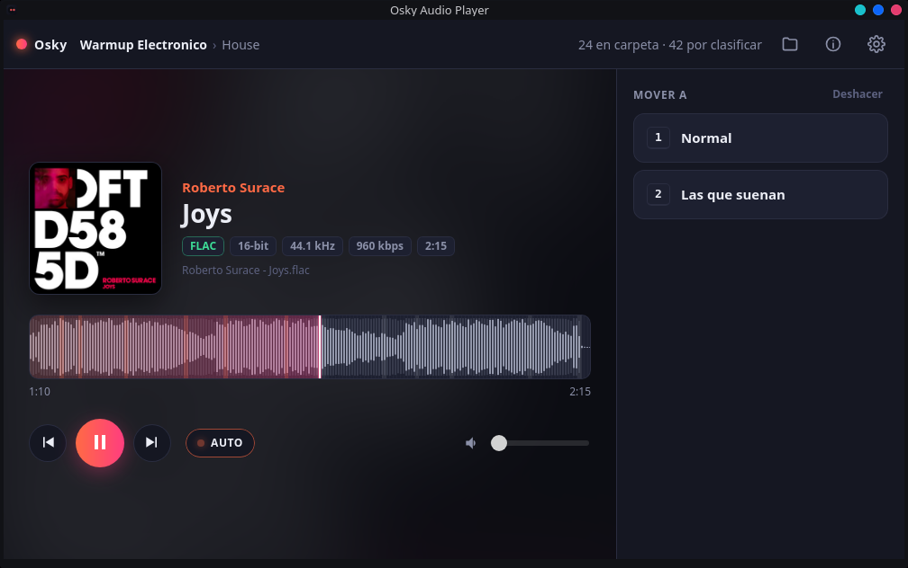
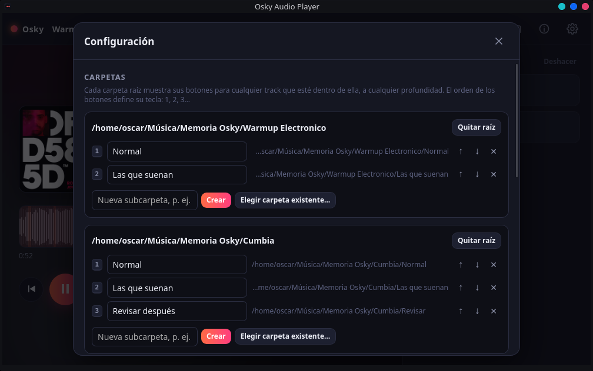
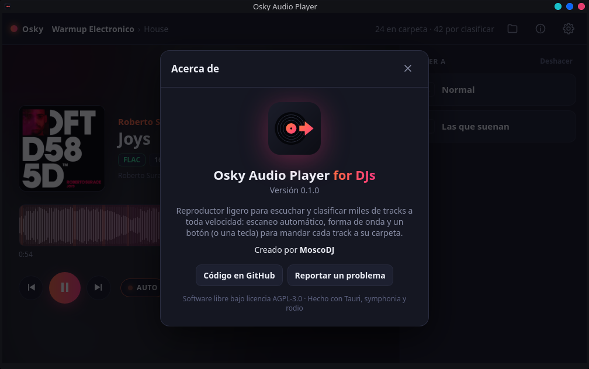

# Osky Audio Player for DJs

Un reproductor ligero hecho para una sola cosa: **escuchar y clasificar miles
de tracks lo más rápido posible**.

Abres un track con doble clic y el reproductor recorre la canción solo,
brincando a puntos repartidos por todo el track. Cuando ya sabes a dónde va,
presionas una tecla (`1`, `2`, `3`…) y en ese momento lo detiene, lo mueve a la
carpeta que corresponde y pasa al siguiente. Nada de stop manual, ni arrastrar
entre ventanas del explorador, ni archivos duplicados por un mal arrastre.



## Cómo funciona

- **Escaneo automático.** El track se divide en N secciones (12 por defecto)
  y suena 1 segundo de un punto al azar dentro de cada una, en orden. Así
  pasa por la intro, el desarrollo, el drop y el final. Al terminar la pasada
  empieza otra con puntos nuevos.
- **Forma de onda.** Se calcula en segundo plano al abrir cada track (menos de
  medio segundo), así ves dónde están los breaks y el drop antes de oírlos.
- **Arte y calidad a la vista.** La portada sale de las etiquetas del archivo.
  El formato, bits, frecuencia y bitrate se marcan en verde, amarillo o rojo,
  así detectas los MP3 de baja calidad mientras escuchas.
- **Manual cuando tú quieras.** Si tocas la línea de tiempo (o usas `←` `→`),
  ese track pasa a manual. El siguiente vuelve a arrancar en automático.
- **Carpetas raíz y destinos.** En la configuración agregas una carpeta raíz
  (p. ej. `Memoria Osky/Warmup Electronico`) y sus destinos (p. ej. `Normal`
  y `Las que suenan`). Puedes agregar todos los destinos que quieras, y pueden
  estar en cualquier ruta. Cualquier track dentro de la raíz, a cualquier
  profundidad, muestra esos botones.
- **Mover y siguiente.** Al mover, el track va directo al destino (sin
  conservar la subcarpeta de origen) junto con su `.lrc`, si tiene. Luego
  suena el siguiente. Cuando una subcarpeta se vacía, salta sola a la
  siguiente, y si quedó vacía la borra (se puede desactivar).
- **Seguro.** Nunca sobrescribe: si ya existe un archivo con el mismo nombre
  en el destino, te avisa y te deja moverlo como `nombre (2)`, saltarlo o
  cancelar. `Ctrl+Z` deshace el último movimiento.
- **Una sola ventana.** Si Osky ya está abierto, el doble clic en otro archivo
  lo carga en la misma ventana.

| Configuración | Acerca de |
|---|---|
|  |  |

### Atajos

| Tecla | Acción |
|---|---|
| `1`…`9`, `0` | Mover al destino 1…10 |
| `Espacio` | Play / pausa |
| `S` | Saltar sin mover |
| `B` | Track anterior |
| `←` `→` | −5 / +5 s (`Shift`: 30 s), pasa a manual |
| `A` | Prender / apagar el escaneo para este track |
| `↑` `↓` | Volumen |
| `Ctrl+Z` | Deshacer el último movimiento |
| `Ctrl+O` | Abrir archivo |
| `Ctrl+,` | Configuración |
| `F1` | Acerca de |

Formatos: MP3, FLAC, WAV, AAC y M4A.

## Tecnología

[Tauri 2](https://tauri.app): el backend en Rust y la interfaz web en JS puro,
sin framework. El audio se decodifica en Rust con
[symphonia](https://github.com/pdeljanov/Symphonia) y sale por
[rodio](https://github.com/RustAudio/rodio), así que no depende de los codecs
del sistema y suena igual en Linux, Windows y macOS.

```
src-tauri/src/
  audio.rs     motor de audio y escaneo automático
  decoder.rs   decodificación (symphonia) con seek en todos los formatos, forma de onda
  library.rs   cola de tracks, metadatos, mover/deshacer
  config.rs    configuración (raíces, destinos, escaneo)
  lib.rs       comandos que llama la interfaz
ui/            interfaz (HTML/CSS/JS)
scripts/       instalación en Linux
```

La configuración se guarda en `~/.config/mx.osky.audioplayer/config.json`
(Linux), `%APPDATA%\mx.osky.audioplayer\` (Windows) o
`~/Library/Application Support/mx.osky.audioplayer/` (macOS).

## Desarrollo

Requisitos: [Rust](https://rustup.rs), Node.js 18+ y, en Linux (Debian/Ubuntu):

```bash
sudo apt install libwebkit2gtk-4.1-dev libxdo-dev libayatana-appindicator3-dev librsvg2-dev libasound2-dev
```

```bash
npm install
npm run dev                     # modo desarrollo
./scripts/install-linux.sh      # compila, instala en ~/.local y lo deja como predeterminado
npm run build                   # paquetes instalables (.deb/.AppImage, .msi, .dmg según el sistema)
```

En modo desarrollo se le puede pasar un archivo:
`npm run tauri dev -- -- "/ruta/al/track.flac"`.

## Licencia

Osky Audio Player es software libre: puedes usarlo, estudiarlo, modificarlo y
redistribuirlo bajo los términos de la
[GNU Affero General Public License v3.0](LICENSE) o posterior. Si distribuyes
una versión modificada, o la ofreces como servicio en red, debes publicar
también su código fuente bajo la misma licencia.

© 2026 MoscoDJ
